# 🚒 Super Noah

**Ein buntes Jump & Run für Kinder ab etwa 5 Jahren – mit Dinos, Feuerwehr, Weltraum, Eis, Meer und Robotern. Läuft komplett im Browser, ohne Installation, ohne Internet, ohne Server.**

*Super Noah is a colourful browser-based jump & run for young children. Open `index.html` and play – no install, no build step, no network. Works with keyboard, gamepad or touchscreen. The game is in German and reads signs and hints aloud.*

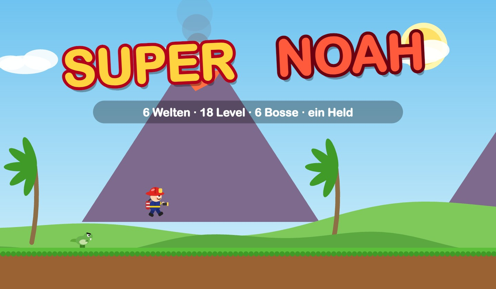

## Spielen

1. Repository herunterladen (**Code → Download ZIP**) oder klonen.
2. **`index.html`** per Doppelklick öffnen. Das Spiel startet im Standardbrowser (Chrome, Edge, Firefox oder Safari).
3. **▶ Spielen** → freien Platz wählen → Namen eingeben → auf der Karte **▶ Los!**

Zum Mitnehmen auf einen anderen Computer einfach den ganzen Ordner kopieren. Es gibt keine Abhängigkeiten und keinen Build-Schritt.

**Auf Tablet oder Handy:** Dort lässt sich eine lokale HTML-Datei meist nicht direkt öffnen. Am einfachsten legt man den Ordner auf einen beliebigen Webspace (z. B. GitHub Pages oder Cloudflare) und öffnet die Adresse im Browser. Mit „Zum Home-Bildschirm hinzufügen“ startet das Spiel dann wie eine App. Das Spiel läuft im Querformat.

## Sechs Welten, achtzehn Level

Jede Welt hat ihre eigene Spielidee, drei Level und am Ende einen Boss. In jedem Level warten **drei Schätze** – insgesamt 54.

| | |
|:---:|:---:|
| 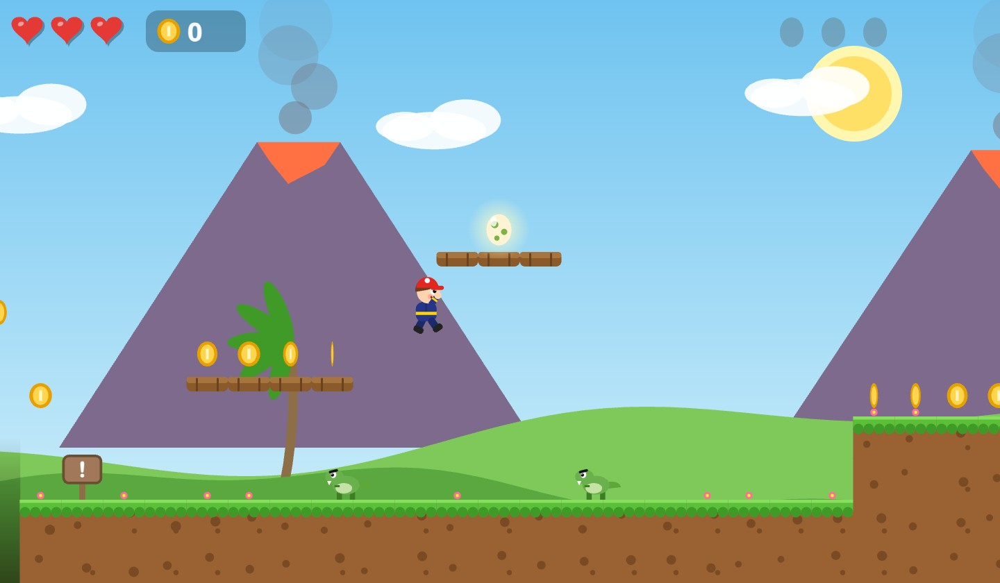 | 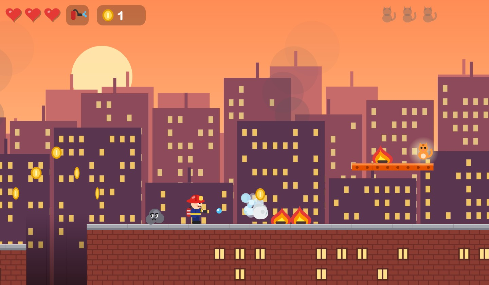 |
| **🦕 Dino-Tal** – Mini-Raptoren, Flugsaurier, Lava-Feuerbälle. Schätze: Dino-Eier. | **🚒 Feuerwehr-Stadt** – mit der Wasserspritze Feuer löschen und Kätzchen retten. |
| 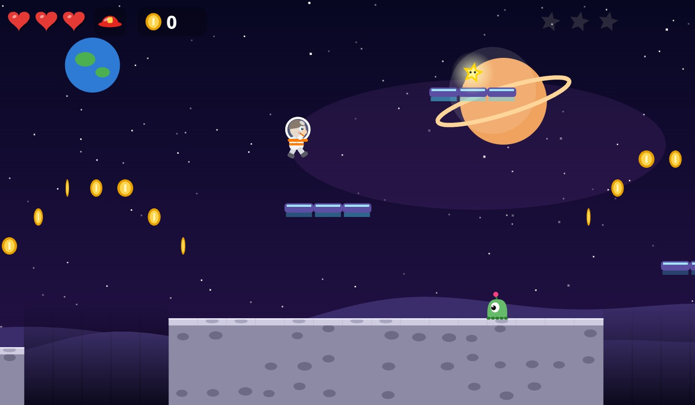 | 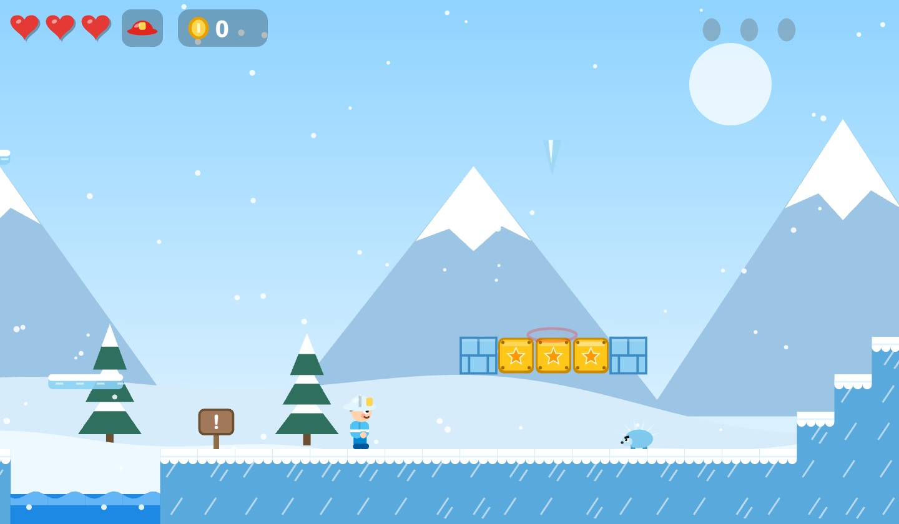 |
| **🚀 Weltraum** – wenig Schwerkraft, riesige Sprünge, Meteoriten. Schätze: Sterne. | **❄️ Eis-Land** – rutschiger Boden, fallende Eiszapfen, Pinguin-Babys retten. |
| 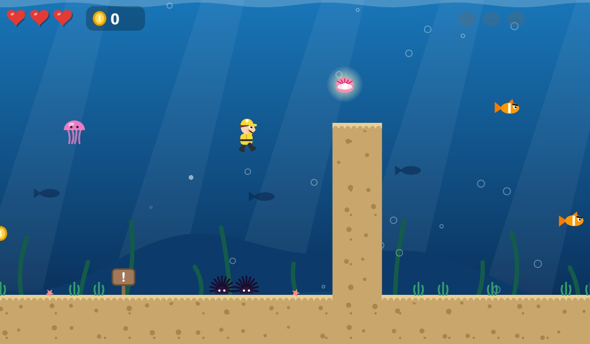 | 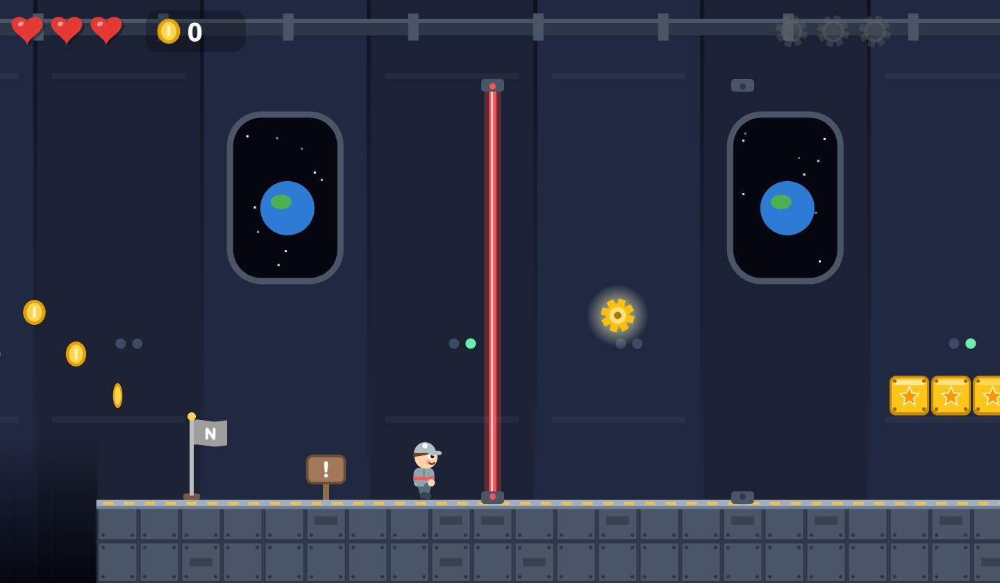 |
| **🌊 Tiefsee** – hier wird geschwommen! Quallen, Seeigel, ein versunkenes Schiff und Perlen. | **🤖 Roboter-Station** – Laufbänder, Laser-Schranken, Schwebe-Plattformen und goldene Zahnräder. |

### Die Bosse

| 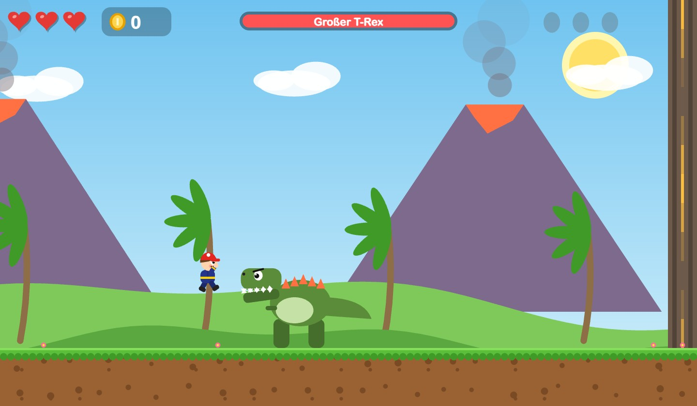 | 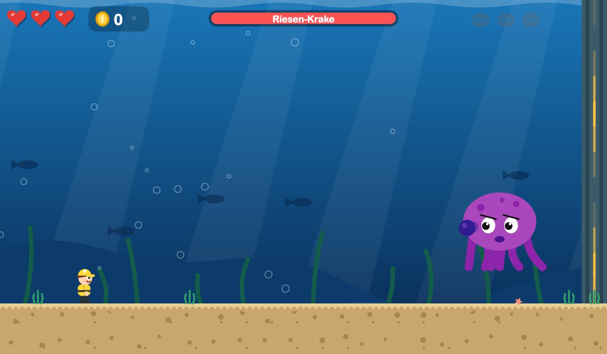 |
|:---:|:---:|
| **Großer T-Rex** – dreimal auf den Kopf hüpfen | **Riesen-Krake** – spritzt Tinte, von oben anschwimmen |

Außerdem warten der **Feuer-Riese** (wirft Feuerbälle, Wasser hilft), das **Alien-UFO** (kommt ab und zu herunter), der **Schnee-Yeti** (wirft Schneebälle) und als Endgegner der **Mega-Roboter**, der Blitze schießt. Nach jedem Sieg öffnet sich das Tor, und der dritte Schatz erscheint.

### Die Weltkarte

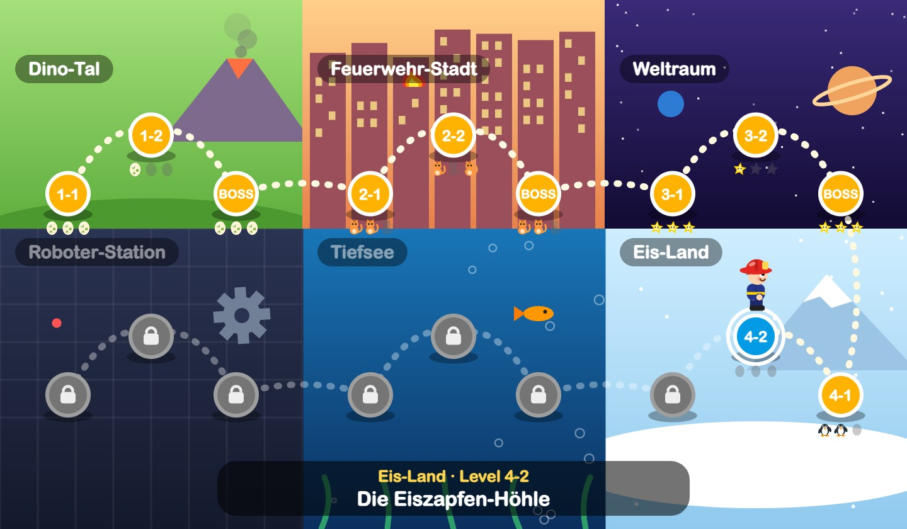

Die Level werden nacheinander freigeschaltet. Unter jedem Level zeigt die Karte, welche Schätze schon gefunden sind.

## Steuerung

| | Tastatur | Tablet / Handy | Gamepad |
|---|---|---|---|
| Laufen | ← → (oder A / D) | ◀ ▶ | Steuerkreuz / Stick |
| Springen / Schwimmen | Leertaste oder ↑ (länger drücken = höher; im Meer gedrückt halten) | roter ⬆-Knopf | A |
| Wasser spritzen | X (gedrückt halten) | blauer 💦-Knopf | X |
| Pause | P oder Esc | ⏸ | Start |

Auf Touch-Geräten erscheinen die großen Knöpfe automatisch. In den Einstellungen lassen sie sich auch dauerhaft ein- oder ausschalten.

## Kindgerecht gemacht

- **Kein Game Over:** Wer alle Herzen verliert oder herunterfällt, startet einfach an der letzten Fahne neu. Fahnen füllen die Herzen wieder auf.
- **Vorlesen:** Schilder und Tipps werden mit der Sprachausgabe des Browsers auf Deutsch vorgelesen und sprechen das Kind mit seinem eingegebenen Namen an. Abschaltbar in den Einstellungen.
- **Faire Sprünge:** Springen klappt auch kurz nach der Kante und kurz vor der Landung.
- **Warnungen vor Gefahren:** Laser blinken, bevor sie angehen, und fallende Eiszapfen und Meteoriten zeigen vorher einen roten Kreis.
- **Helfer:** Der Helm schützt einmal vor einem Treffer, die Wasserspritze löscht Feuer und verjagt Gegner.

## Der Kleiderschrank

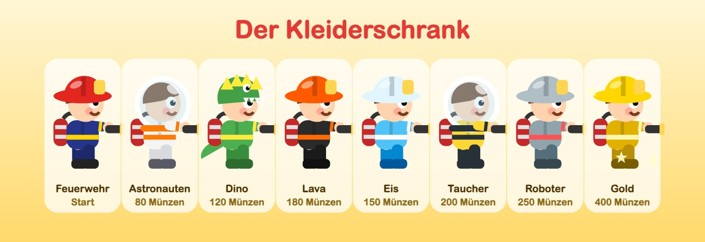

Mit den gesammelten Münzen kauft man neue Kostüme. Die Kostüme sind nur zum Anschauen und verändern das Spiel nicht.

## Spielstände

- Es gibt **3 Spielplätze**, zum Beispiel für Geschwister. Der Fortschritt wird nach jedem Level automatisch im **lokalen Speicher des Browsers** gespeichert.
- **Exportieren:** auf der Karte **💾 Spielstand → Als Datei exportieren** (oder 💾 auf der Spielerauswahl). Es entsteht eine Datei `SuperNoah-Name-Datum.supernoah.json`.
- **Importieren:** **📂 Spielstand importieren**, Datei auswählen und einen Platz wählen.
- Der Browser-Speicher gehört zum jeweiligen Gerät und Browser. Wer Browserdaten löscht, löscht auch die Spielstände. Wichtige Spielstände daher als Datei exportieren.

## Eigene Level bauen

Alle Level stehen in [`js/data.js`](js/data.js) und werden mit einem kleinen Baukasten beschrieben. Ein Beispiel:

```js
build(L) {
  L.ground(0, 24);                          // Boden von Spalte 0 bis 24
  L.sign(3, 11, 'Hallo {name}! {move}');    // Schild, wird vorgelesen
  L.blocks(12, 8, 'bqbhb');                 // Steine (b), Münzkisten (q), Helm-Kiste (h)
  L.walker(21, 11);                         // ein Gegner
  L.coinArc(24, 9, 4);                      // Münzbogen über einer Lücke
  L.ground(27, 46);
  L.plat(37, 6, 3); L.star(38, 5);          // Plattform mit Schatz
  L.goal(44, 11);                           // Ziel
}
```

Weitere Bausteine sind unter anderem `spring`, `mplat` (bewegliche Plattform), `fire`, `lava`, `meteors`, `jelly`, `urchin`, `laser`, `conv` (Laufband), `check` (Fahne) und `boss`.

## Projektaufbau

```
SuperNoah/
├── index.html          Einstiegspunkt und Menüs
├── css/style.css       Oberfläche
├── js/
│   ├── data.js         Kostüme, Welten, Physik und alle Level (Level-Baukasten)
│   ├── audio.js        Soundeffekte, Musik und Sprachausgabe
│   ├── save.js         Spielstände, Export und Import
│   ├── render.js       Zeichnen von Noah, Gegnern und den Welten 1–3
│   ├── render2.js      Zeichnen der Welten 4–6 und der Weltkarte
│   ├── game.js         Physik, Gegner, Bosse, Kamera und Spielschleife
│   └── ui.js           Menüs, Kleiderschrank, Ergebnis
├── _headers, robots.txt   optional: hält Suchmaschinen fern, wenn das Spiel online liegt
└── docs/screenshots/   Bilder für diese Seite
```

Reines JavaScript ohne Frameworks oder Bibliotheken. Die Skripte werden als klassische `<script>`-Tags geladen und nicht als ES-Module, damit das Spiel auch direkt von der Festplatte (`file://`) läuft. Alle Grafiken werden zur Laufzeit auf einem Canvas gezeichnet, Musik und Klänge mit der Web-Audio-API erzeugt. Es gibt keine Bild- oder Tondateien.

## Lizenz

Super Noah steht unter der [MIT-Lizenz](LICENSE). Du darfst den Code frei verwenden, verändern und weitergeben, solange der Urheberhinweis erhalten bleibt.

## Hinweis

Super Noah ist ein eigenständiges, unabhängiges Projekt. Figuren, Grafiken, Musik, Texte und Code wurden eigens für dieses Spiel erstellt. Es steht in keiner Verbindung zu anderen Spielen, Spielefirmen oder deren Marken.
